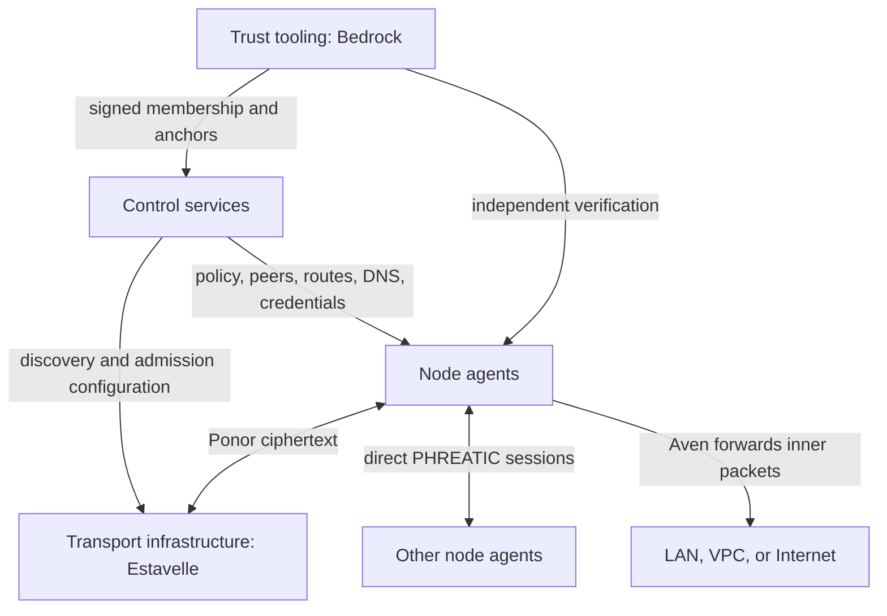

<!-- SPDX-License-Identifier: CC-BY-4.0 -->
# Component architecture

[ADR-0056](adr/0056-four-component-families.md) defines four component families.
The model is accepted; unified runtime configuration, APIs, and UI are tracked
in [#404](https://github.com/karst-net/karst/issues/404). The commands and fields
listed below describe the current implementation, not newly available syntax.

**As of [ADR-0069](adr/0069-resurgence-estavelle-aven-renaming.md) (2026-11-08):**
"Gateway" throughout this document is now **Aven**, and "Relay" is now
**Estavelle** — a clean-break rename of binaries, crates, wire strings and
the console, already applied to the commands and fields below. The #404
migration contract itself is unaffected by the rename; it is a separate,
still-open consolidation of the (now Aven/Estavelle-named) family model.

## Families and responsibilities

| Family | Main functions | Current programs and integrations |
|---|---|---|
| Node agent | Device identity; encrypted sessions; path selection; packet enforcement; local routes/DNS; optional Aven forwarding | `karstd`, `karst`, platform client UI; PHREATIC, Resurgence, KarstDNS |
| Transport infrastructure | One Estavelle (Ponor); presence/bootstrap; discovery reflection; ciphertext transit | `karst-estavelle`; standalone TURN support dropped in favor of Estavelle-only transport fallback |
| Control services | Enrollment; users/groups; policy; netmaps; route/DNS configuration; Estavelle discovery and credentials; administration/audit | `karst-control`, console, portal; IdP/SCIM and SIEM integrations |
| Trust tooling | Bedrock roots/authorities; membership approval/revocation; verifiable chain; audit anchoring | `karst-bedrock`; verification in agents/control; optional scoped online anchor signer |

Protocols are not additional components. Aven is a capability of a node;
subnet access and exit egress are its route behaviors. Estavelle is one
component. Families can share a host without sharing authority.

The arrows describe responsibilities, not extra key-distribution channels:
control transports the signed Bedrock chain and consumers verify it locally.

## Aven: one capability, two route behaviors

| Concern | Specific-prefix behavior (formerly subnet router) | Default-route behavior (formerly exit node) |
|---|---|---|
| Destination | Approved IPv4/IPv6 CIDRs | `0.0.0.0/0` and/or `::/0` |
| Admission | Enrolled aven, approved route/group distribution and packet policy | Same, plus local recipient consent |
| Forwarding | Aven decrypts the overlay session and forwards inner packets | Same; general egress exposes destination metadata and unencrypted payloads |
| Return path | Masquerade, or explicit return routes to the overlay | Same requirement |
| Selection | Distributed candidates, lowest metric and aven-ID tie break | Same candidates, constrained by the locally selected route ID |
| DNS | Mesh/split DNS from client configuration | Must preserve intended mesh/split DNS and disclose which resolver handles Internet queries; choosing an exit alone is not a guarantee against DNS leakage |

One node can serve both behaviors. More-specific routes must retain precedence;
default-route installation must preserve control, peer, and Estavelle underlay
escape paths to prevent recursion. Removing an offer withdraws active routing
and forwarding, not the client's durable consent record. Reusing route IDs
for a different destination or trust context must not silently reuse consent.

The [Aven administration view](aven-capability.md) resolves subnet and default
route declarations into one inventory row per visible enrolled node. It preserves
existing route persistence and APIs, while distinguishing recorded connectivity
from unreported forwarding readiness.

Current route offers already share `route_id`, prefix, gateway ID, metric,
kind, masquerade, and role (`bins/karstd/src/route_offer.rs`). Linux forwarding
uses `aven.rs` and nftables; default-route consent/escape handling uses
`exit_policy.rs`. `karst exit-node use|disable|list`, `exit_node_state_file`,
and reported `subnet`/`exit` kinds remain current interfaces.
`node.aven_exit_state_file` is the canonical local consent-storage setting;
the legacy `node.exit_node_state_file` alias retains the same path and format.
Using both is an error. Older daemons require the legacy spelling; see the
[consent configuration migration](subnet-routers-and-exit-nodes.md#gateway-consent-configuration-migration). The additive
`karst aven status` command reports both route behaviors using the existing
routing report; `karst aven exit list|use|disable` reuses the legacy consent
requests. The status verb requires an updated daemon; consent aliases work
with older daemons. These CLI additions begin #404 without implying completion
of unified configuration, persistence, APIs/UI or Estavelle management.

[Aven operations](subnet-routers-and-exit-nodes.md) describes readiness,
NAT, return routes, restart recovery, and control-session-driven HA. Do not
infer immediate dataplane failover from the family model: existing candidate
withdrawal depends on control-session state and netmap refresh, and session
recovery has its own timing. Linux aven prerequisites are documented there;
macOS recipient consent is documented there and in ADR-0036. A supported
endpoint platform or userspace networking mode does not by itself establish
support for hosting a forwarding Aven; #404 must publish a verified platform
matrix rather than assume parity.

## Estavelle: one service, Ponor only

Ponor supplies persistent peer presence/bootstrap, opaque forwarding, and
Resurgence reflector assistance. Client Resurgence path selection uses direct
connectivity when viable and the co-located estavelle otherwise.

ADR-0056's addendum dropped the standalone TURN fallback this component used
to also support: a managed adapter to coturn or an external TURN provider was
one of two options #403/ADR-0056 originally left open for combining Ponor and
TURN, and the simpler alternative — drop TURN, Estavelle-only — was chosen
instead once the Aven inventory and Estavelle Services work made the added
complexity of a second, independently-authenticated transport mode hard to
justify for the coverage it bought. The target Estavelle service has one
operator-facing identity/record associating its Ponor endpoints, mode
enablement, readiness, lifecycle, limits, and accounting.

**Current implementation:** `karst-estavelle` serves Ponor and its reflector.
Control reads the Estavelle registry and sends `relays` netmap data. See
[`deploy/compose/README.md`](../deploy/compose/README.md) and
`bins/karstd/src/netmap.rs`.

Operational requirements for the component:

- Publish usable endpoints and protocol-specific authentication material:
  Ponor identity pins, TLS names, and admission rosters.
- Refresh Ponor roster leases before expiry; never treat a cached expired
  credential as a healthy path.
- Track presence, admissions, expiry, latency, capacity, reconnect, and
  failover.
- Enforce Ponor admission and rate limits. A shared view must not turn the
  mode into an open relay.
- Redact secrets from diagnostics. Ponor does not read overlay plaintext.

The additive [Estavelle service association API](estavelle-services.md) stores an
explicit account-local Ponor link. Its presence field describes registry
availability, not runtime health. Legacy credential minting and wire
projections remain in use. Operators can preview and explicitly enable
service-based publication, or retain legacy registry publication. The
reference Compose [deployment adapter](../deploy/compose/README.md#estavelle-deployment-adapter)
and the bare-metal [systemd adapter](../deploy/systemd/README.md#estavelle-deployment-adapter)
each manage the Ponor process mode from one manifest without changing account
publication. A Kubernetes adapter remains pending. The Estavelle console
groups service associations and existing Ponor backend controls in one view.
Explicit mode controls withdraw service endpoints without deleting backend
configuration. Versioned persistence guards older service-aware control
against ignoring those flags. Updated agents support live
activation/withdrawal on unchanged netmaps.

### Current transport limits

The Resurgence specification's [path-selection rules](../spec/resurgence-v1.md#8-path-selection)
and [open items](../spec/resurgence-v1.md#12-open-items--this-draft-is-incomplete)
remain authoritative.

## Ownership at overlaps

| Function | Decision/distribution | Enforcement or execution |
|---|---|---|
| Enrollment | Control associates device with owner/groups | Node proves possession; enforcing Bedrock verifier requires signed coverage |
| Membership approval | Independent Bedrock root/authority custody | Control transports signed chain; clients verify their local mode floor |
| Reachability policy | Control compiles account rules | Node and Aven enforce permitted traffic |
| Routing | Control approves/distributes candidate offers | Recipient selects/consents; Aven forwards only granted prefixes |
| Transport | Control publishes Estavelle modes and credentials | Estavelle backends authenticate/admit; clients discover/select paths |
| Naming | Control distributes names and resolver configuration | KarstDNS resolves locally and applies/reverts host DNS |
| Audit | Control records events; components emit bounded diagnostics | Bedrock anchor fixes a history point; consumers verify, without asserting completeness |

Console access does not convey Bedrock signing authority. An online anchor key
can sign only anchors. Estavelle transit does not convey Aven forwarding rights.
An Aven sees inner packets for its routes; application encryption may remain.

## Migration contract for #404

This documentation change does not alter wire formats, storage, or CLI behavior.
The implementation must provide the following compatibility path:

1. **Inventory and normalization:** map existing subnet/exit route records into
   one Aven model without changing route IDs, approved prefixes, groups,
   metrics, NAT settings, recipient choices, or consent. Map Estavelle records
   into explicit service/backend associations; never infer an association
   solely from a matching IP, region, or provider.
2. **Additive rollout:** introduce versioned/additive API and persistence support
   before changing writers. Keep existing CLI/config aliases and separate
   wire projections for older clients while supported. Preserve route kinds
   and authenticated netmap bindings; the family model is not a wire rename.
3. **Validation:** reject conflicting legacy/new settings with an actionable
   error; never select one silently. Validate all consumers before enabling
   new mandatory fields or modes. Unsupported combinations fail explicitly;
   an unknown mode cannot become an unencrypted path or an automatic exit.
4. **Transport and security state:** preserve node/Estavelle identity pins and
   Bedrock trust state. Backend credentials remain scoped, short-lived, and
   redacted; no shared secret moves into a client map. Version any changed
   authenticated encoding and coordinate its rollout with protocol specs.
5. **Operator migration:** supply a dry-run report of old-to-new associations,
   permissions, and deployment changes, plus backup/restore instructions.
   Preserve current ports/profile behavior until a documented migration exists.
6. **Verification and rollback:** test old/new client and control combinations,
   both Aven behaviors together, local consent across restart, policy denial,
   route precedence, IPv4/IPv6/DNS, Estavelle failover, expiry,
   admission, and Bedrock enforcement. Keep old projections during the support
   window. Publish its concrete version boundaries in #404 before removal.
   Rollback must not activate dormant routes, clear client consent, rotate
   identities, or reinterpret unknown fields as permission.

Unified presentation must retain per-mode diagnostics and per-route detail.
Implementation completion requires behavior and migration evidence, not just
renaming UI labels or moving code between directories.

## Documentation inventory and historical references

| Surface | Treatment |
|---|---|
| README and getting-started component tables | Four families; binaries and deployed processes listed within them |
| Use cases UC-02, UC-07–UC-10 and connectivity diagram | Combined Estavelle and Aven responsibilities, consent and independent trust |
| Operations, Aven reference, migration guide, customer scenarios, console and Compose guides | Consistent terms with current commands retained and pending consolidation identified |
| Threat model and security whitepaper | Estavelle ciphertext transit versus Aven tunnel termination; separate signing custody |
| Ponor, Resurgence, KARST-CONTROL, Bedrock specs | Link this architecture without changing protocol names, signed encodings, or wire fields |
| ADR-0008 and ADR-0010 | Explicit partial supersession; historical rationale retained |
| Bedrock ADR-0014 and ADR-0016 | Cross-reference ownership; cryptographic authority rules unchanged |
| Archived PLAN.md and plans/ | Preserve dated implementation records and old identifiers; current architecture notice points here |

Terms such as “exit node,” “subnet router,” “TURN server,” “Relay” and
“Gateway” remain valid in historical records, protocol descriptions, CLI
examples, and backend-specific operations predating ADR-0069. They do not
designate additional conceptual families. The legacy Gateway document path
and UC-07 anchor remain stable so external links work.
