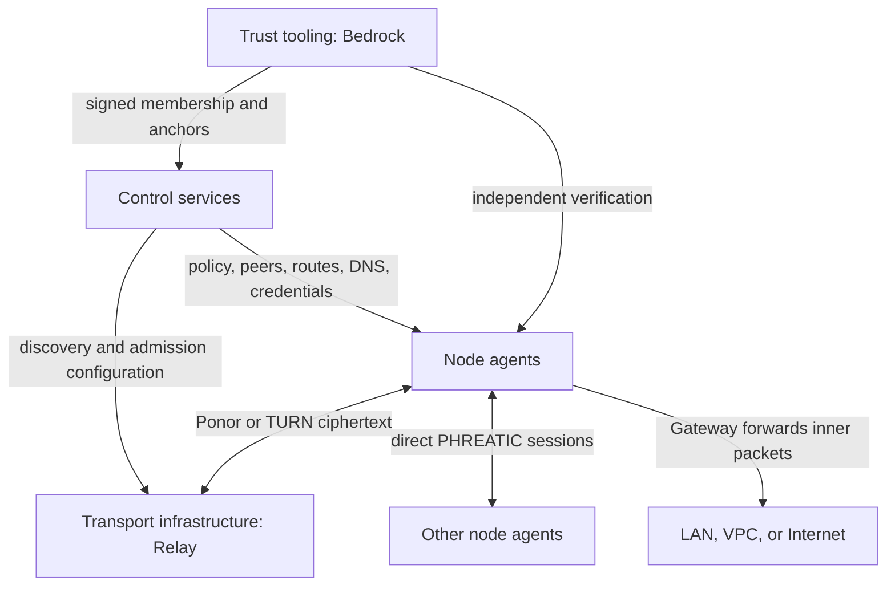

<!-- SPDX-License-Identifier: CC-BY-4.0 -->
# Component architecture

[ADR-0056](adr/0056-four-component-families.md) defines four component families.
The model is accepted; unified runtime configuration, APIs, and UI are tracked
in [#404](https://github.com/karst-net/karst/issues/404). The commands and fields
listed below describe the current implementation, not newly available syntax.

## Families and responsibilities

| Family | Main functions | Current programs and integrations |
|---|---|---|
| Node agent | Device identity; encrypted sessions; path selection; packet enforcement; local routes/DNS; optional Gateway forwarding | `karstd`, `karst`, platform client UI; PHREATIC, AVEN, KarstDNS |
| Transport infrastructure | One Relay with Ponor and TURN modes; presence/bootstrap; discovery reflection; ciphertext transit | `karst-relay` plus optional coturn or an external TURN provider; managed adapter consolidation pending #404 |
| Control services | Enrollment; users/groups; policy; netmaps; route/DNS configuration; Relay discovery and credentials; administration/audit | `karst-control`, console, portal; IdP/SCIM and SIEM integrations |
| Trust tooling | Bedrock roots/authorities; membership approval/revocation; verifiable chain; audit anchoring | `karst-bedrock`; verification in agents/control; optional scoped online anchor signer |

Protocols are not additional components. Gateway is a capability of a node;
subnet access and exit egress are its route behaviors. Relay is one component
with two transport modes. Families can share a host without sharing authority.

The arrows describe responsibilities, not extra key-distribution channels:
control transports the signed Bedrock chain and consumers verify it locally.

## Gateway: one capability, two route behaviors

| Concern | Specific-prefix behavior (formerly subnet router) | Default-route behavior (formerly exit node) |
|---|---|---|
| Destination | Approved IPv4/IPv6 CIDRs | `0.0.0.0/0` and/or `::/0` |
| Admission | Enrolled gateway, approved route/group distribution and packet policy | Same, plus local recipient consent |
| Forwarding | Gateway decrypts the overlay session and forwards inner packets | Same; general egress exposes destination metadata and unencrypted payloads |
| Return path | Masquerade, or explicit return routes to the overlay | Same requirement |
| Selection | Distributed candidates, lowest metric and gateway-ID tie break | Same candidates, constrained by the locally selected route ID |
| DNS | Mesh/split DNS from client configuration | Must preserve intended mesh/split DNS and disclose which resolver handles Internet queries; choosing an exit alone is not a guarantee against DNS leakage |

One node can serve both behaviors. More-specific routes must retain precedence;
default-route installation must preserve control, peer, and Relay underlay
escape paths to prevent recursion. Removing an offer withdraws active routing
and forwarding, not the client's durable consent record. Reusing route IDs
for a different destination or trust context must not silently reuse consent.

Current route offers already share `route_id`, prefix, gateway ID, metric,
kind, masquerade, and role (`bins/karstd/src/route_offer.rs`). Linux forwarding
uses `gateway.rs` and nftables; default-route consent/escape handling uses
`exit_policy.rs`. `karst exit-node use|disable|list`, `exit_node_state_file`,
and reported `subnet`/`exit` kinds remain current interfaces. The additive
`karst gateway status` command reports both route behaviors using the existing
routing report; `karst gateway exit list|use|disable` reuses the legacy consent
requests. The status verb requires an updated daemon; consent aliases work
with older daemons. These CLI additions begin #404 without implying completion
of unified configuration, persistence, APIs/UI or Relay management.

[Gateway operations](subnet-routers-and-exit-nodes.md) describes readiness,
NAT, return routes, restart recovery, and control-session-driven HA. Do not
infer immediate dataplane failover from the family model: existing candidate
withdrawal depends on control-session state and netmap refresh, and session
recovery has its own timing. Linux gateway prerequisites are documented there;
macOS recipient consent is documented there and in ADR-0036. A supported
endpoint platform or userspace networking mode does not by itself establish
support for hosting a forwarding Gateway; #404 must publish a verified platform
matrix rather than assume parity.

## Relay: one service, Ponor and TURN modes

Ponor supplies persistent peer presence/bootstrap, opaque forwarding, and AVEN
reflector assistance. TURN supplies allocated relay addresses and permission/
channel state; it does not replace Ponor presence. Client AVEN path selection
uses direct connectivity when viable and supported relay modes otherwise.

ADR-0056 chooses a managed TURN adapter. The target Relay service has one
operator-facing identity/record associating its Ponor endpoints and optional
TURN backends, mode enablement, readiness, lifecycle, limits, and accounting.
Each mode retains its own authentication and protocol state. A provider's
failure must remain visible even while Ponor is healthy, and vice versa.
Co-location is optional; an external backend's location and operator must be
disclosed rather than inferred from its associated Ponor host.

**Current implementation:** `karst-relay` serves Ponor and its reflector; it
is not an embedded TURN server. Compose can deploy coturn as a companion via
`bootstrap.sh --turn` and the `turn` profile. Control reads separate Relay and
TURN registries and sends separate `relays` and `turn_servers` netmap data.
The client maintains separate Ponor and TURN connection workers. See
[`deploy/compose/README.md`](../deploy/compose/README.md#turn-fallback-optional),
`bins/karstd/src/netmap.rs`, and `bins/karstd/src/turn.rs`.

Operational requirements for the combined component:

- Publish usable endpoints and protocol-specific authentication material;
  Ponor identity pins, TLS names, and admission rosters remain distinct from
  TURN time-limited credentials and backend shared secrets.
- Refresh Ponor roster leases and TURN credentials/allocations before expiry;
  never treat cached expired credentials as a healthy path.
- Track presence, admissions, allocation/permission/channel failures, expiry,
  mode-specific latency, capacity, bandwidth/quotas, reconnect, and failover.
- Enforce backend allocation/port limits and quotas as well as Ponor admission
  and rate limits. A shared view must not turn either mode into an open relay.
- Redact secrets from diagnostics; disclose the backend operator's access to
  traffic endpoints, timing, and volume. Neither mode reads overlay plaintext.

These requirements are acceptance targets for #404, not claims that a unified
health endpoint or provider lifecycle adapter already exists.

The additive [Relay service association API](relay-services.md) stores explicit
account-local Ponor/TURN links and backend operator declarations. Its per-mode
presence fields describe registry availability, not runtime health. Legacy
registries, credential minting and wire projections remain in use while the
managed adapter, service lifecycle and UI integration are implemented.

### Current transport limits

The AVEN specification's [path-selection rules](../spec/aven-v1.md#8-path-selection)
and [open items](../spec/aven-v1.md#12-open-items--this-draft-is-incomplete)
remain authoritative. Current Ponor-versus-TURN choice is structural, not a new
latency-based comparison supplied by the combined model. The measured TURN
path assumes a shared TURN host per account; different per-peer TURN hosts can
still reproduce the documented dispatch failure. #404 must test and resolve
or explicitly reject unsupported backend combinations before offering them
through the unified service. Association with one Relay record alone does not
make an arbitrary multi-backend topology work.

## Ownership at overlaps

| Function | Decision/distribution | Enforcement or execution |
|---|---|---|
| Enrollment | Control associates device with owner/groups | Node proves possession; enforcing Bedrock verifier requires signed coverage |
| Membership approval | Independent Bedrock root/authority custody | Control transports signed chain; clients verify their local mode floor |
| Reachability policy | Control compiles account rules | Node and Gateway enforce permitted traffic |
| Routing | Control approves/distributes candidate offers | Recipient selects/consents; Gateway forwards only granted prefixes |
| Transport | Control publishes Relay modes and credentials | Relay backends authenticate/admit; clients discover/select paths |
| Naming | Control distributes names and resolver configuration | KarstDNS resolves locally and applies/reverts host DNS |
| Audit | Control records events; components emit bounded diagnostics | Bedrock anchor fixes a history point; consumers verify, without asserting completeness |

Console access does not convey Bedrock signing authority. An online anchor key
can sign only anchors. Relay transit does not convey Gateway forwarding rights.
A Gateway sees inner packets for its routes; application encryption may remain.

## Migration contract for #404

This documentation change does not alter wire formats, storage, or CLI behavior.
The implementation must provide the following compatibility path:

1. **Inventory and normalization:** map existing subnet/exit route records into
   one Gateway model without changing route IDs, approved prefixes, groups,
   metrics, NAT settings, recipient choices, or consent. Map separate Relay and
   TURN records into explicit service/backend associations; never infer an
   association solely from a matching IP, region, or provider.
2. **Additive rollout:** introduce versioned/additive API and persistence support
   before changing writers. Keep existing CLI/config aliases and separate
   wire projections for older clients while supported. Preserve route kinds
   and authenticated netmap bindings; the family model is not a wire rename.
3. **Validation:** reject conflicting legacy/new settings with an actionable
   error; never select one silently. Validate all consumers before enabling
   new mandatory fields or modes. Unsupported combinations fail explicitly;
   an unknown mode cannot become an unencrypted path or an automatic exit.
4. **Transport and security state:** preserve node/Relay identity pins and
   Bedrock trust state. Backend credentials remain scoped, short-lived, and
   redacted; no shared secret moves into a client map. Version any changed
   authenticated encoding and coordinate its rollout with protocol specs.
5. **Operator migration:** supply a dry-run report of old-to-new associations,
   permissions, and deployment changes, plus backup/restore instructions.
   Preserve current ports/profile behavior until a documented migration exists.
   External TURN remains supported through the adapter; external processes
   are not stopped by a local service disable unless explicitly managed.
6. **Verification and rollback:** test old/new client and control combinations,
   both Gateway behaviors together, local consent across restart, policy denial,
   route precedence, IPv4/IPv6/DNS, both Relay modes and failover, expiry,
   admission, and Bedrock enforcement. Keep old projections during the support
   window. Publish its concrete version boundaries in #404 before removal.
   Rollback must not activate dormant routes, clear client consent, rotate
   identities, or reinterpret unknown fields as permission.

Unified presentation must retain per-mode diagnostics and per-route detail.
Implementation completion requires behavior and migration evidence, not just
renaming UI labels or moving code between directories.

## Documentation inventory and historical references

| Surface | Treatment |
|---|---|
| README and getting-started component tables | Four families; binaries and deployed processes listed within them |
| Use cases UC-02, UC-07–UC-10 and connectivity diagram | Combined Relay and Gateway responsibilities, consent and independent trust |
| Operations, Gateway reference, migration guide, customer scenarios, console and Compose guides | Consistent terms with current commands retained and pending consolidation identified |
| Threat model and security whitepaper | Relay ciphertext transit versus Gateway tunnel termination; separate signing custody |
| Ponor, AVEN, KARST-CONTROL, Bedrock specs | Link this architecture without changing protocol names, signed encodings, or wire fields |
| ADR-0008 and ADR-0010 | Explicit partial supersession; historical rationale retained |
| Bedrock ADR-0014 and ADR-0016 | Cross-reference ownership; cryptographic authority rules unchanged |
| Archived PLAN.md and plans/ | Preserve dated implementation records and old identifiers; current architecture notice points here |

Terms such as “exit node,” “subnet router,” and “TURN server” remain valid in
historical records, protocol descriptions, CLI examples, and backend-specific
operations. They do not designate additional conceptual families. The legacy
Gateway document path and UC-07 anchor remain stable so external links work.
